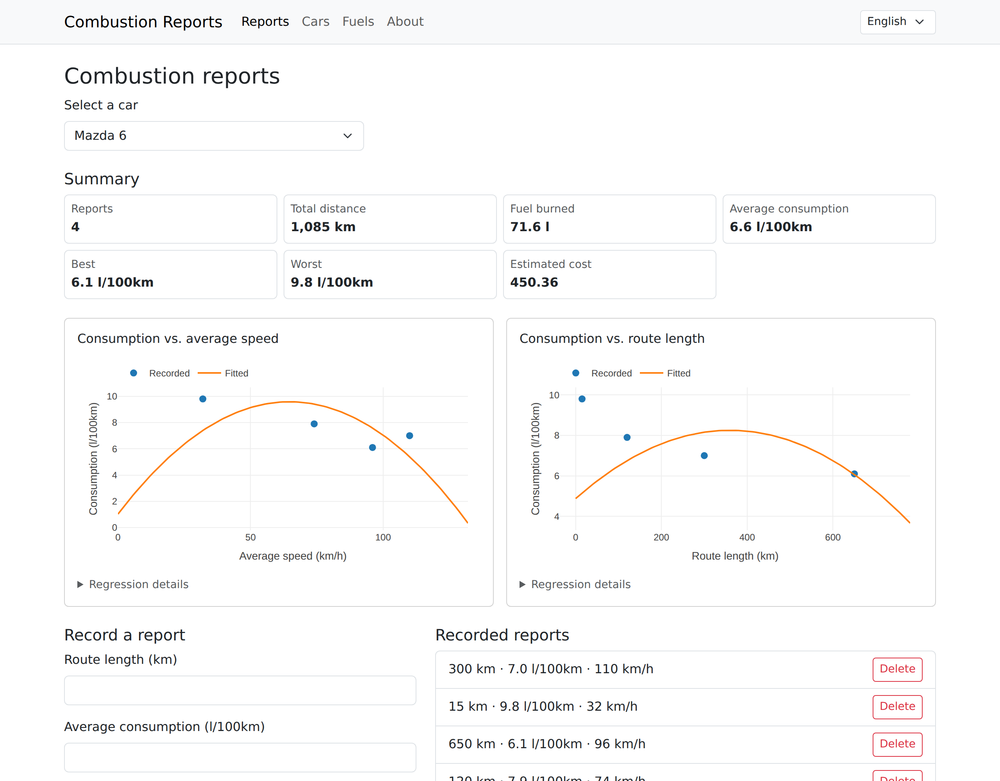
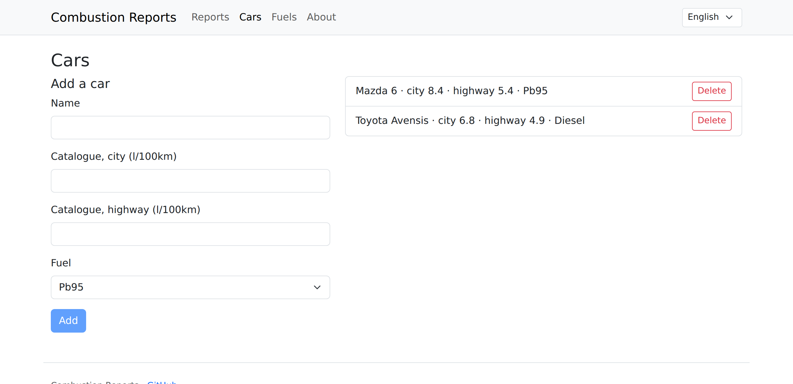
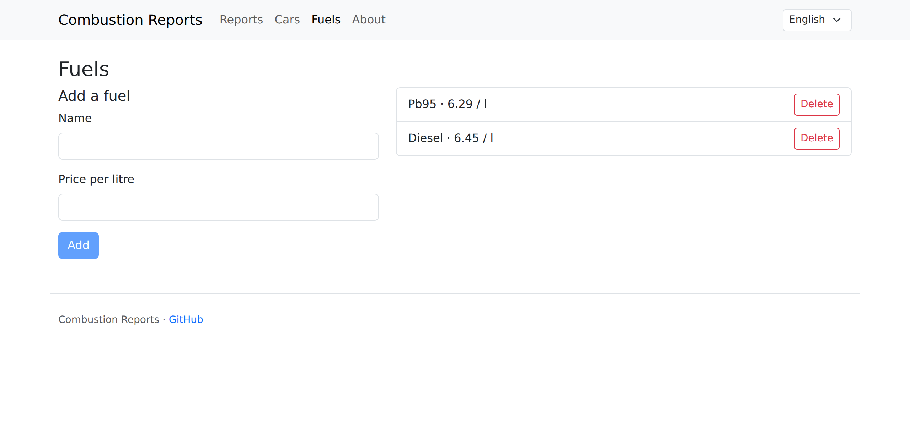
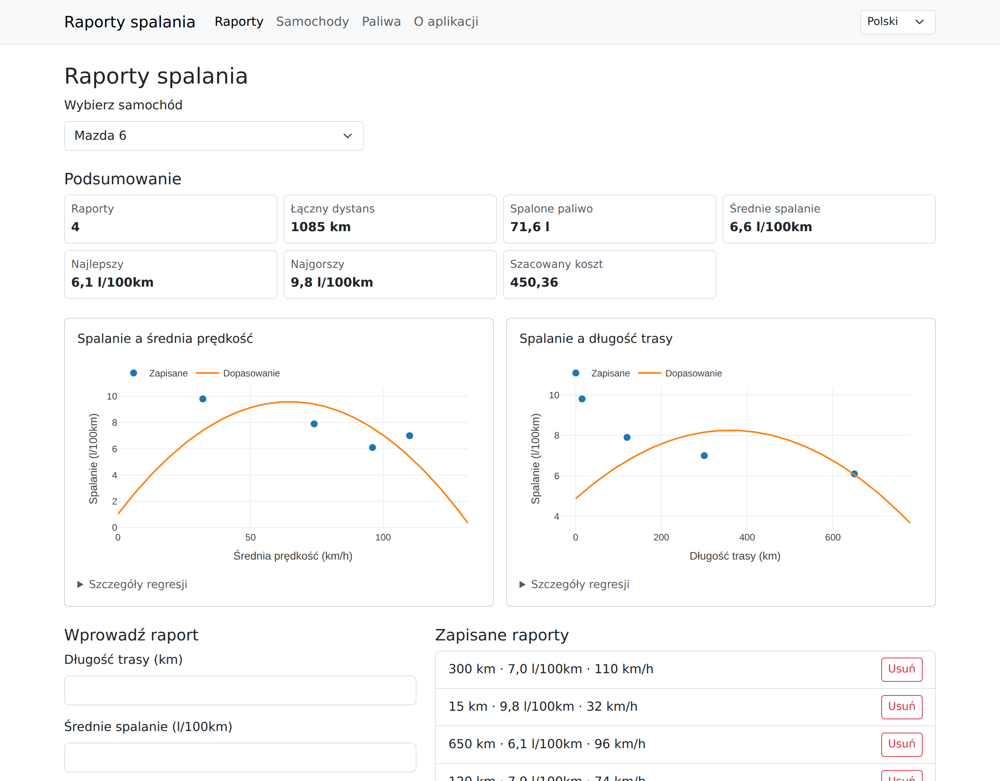
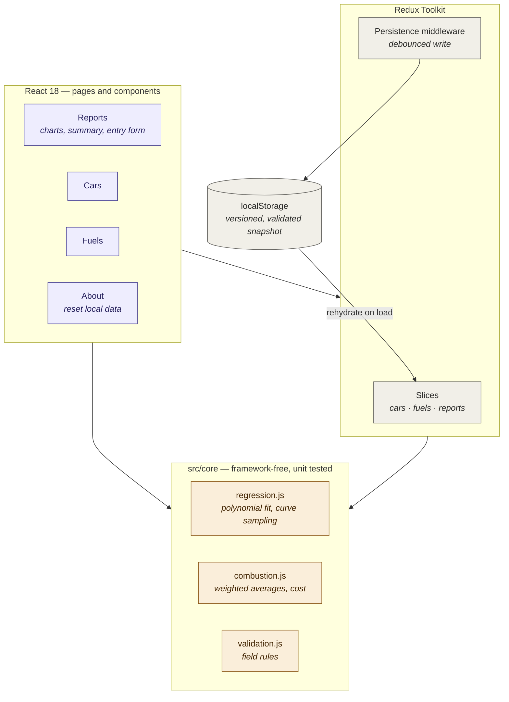

# CombustionReports

[](https://github.com/konradcinkusz/CombustionReports/actions/workflows/ci.yml)
[](LICENSE)
[](https://nodejs.org/)
[](https://react.dev/)
[](https://vite.dev/)

**Find out what your car actually burns, and where.**

Manufacturers quote two numbers — city and highway. Your car has a curve. Record
what you really used on each trip and CombustionReports fits a polynomial model
of consumption against average speed and against route length, so you can see
where a car is genuinely efficient rather than where the brochure says it is.

Runs entirely in your browser. No account, no server, no telemetry, nothing
leaving the machine.



```bash
git clone https://github.com/konradcinkusz/CombustionReports.git
cd CombustionReports
npm install
npm run dev          # http://localhost:5173
```

That is the whole setup. No database, no API keys, no `.env`.

## What it shows you

| Signal | Question it answers |
|---|---|
| Consumption vs. **average speed** | At what pace does this car stop being efficient? |
| Consumption vs. **route length** | How much is the cold-start penalty costing on short trips? |
| **Distance-weighted** average | What is the real figure — not the mean of a 15 km hop and a 2 000 km haul |
| Fuel burned and estimated cost | What those trips actually cost, at the fuel price you recorded |
| Best / worst trip | The range you're actually driving in |
| R² and the fitted equation | How much to trust the curve — shown, not hidden |

The two charts are the point. A single "average consumption" figure hides the
thing you can act on: most cars have a speed band where they are markedly better,
and short trips are far more expensive per kilometre than people expect. A curve
shows both; an average shows neither.

## How not to read it

- **A curve fitted to four points is a drawing, not a model.** R² is displayed
  next to every fit for exactly this reason. Record a dozen trips before
  believing the shape.
- **The fit is anchored at the origin by default.** That is not physically true —
  a car idling at 0 km/h still burns fuel — but without it, a handful of samples
  produces a curve that swings wildly outside the range you actually drove. It
  is a stability trade-off, it is opt-out
  (`fitPolynomial(points, { anchorAtOrigin: false })`), and it is worth knowing
  before reading anything into the left-hand end of the chart.
- **Extrapolation is deliberately short.** The curve is drawn to 1.2× your
  fastest or longest sample and no further. A degree-2 polynomial says nothing
  credible past the data.
- **Your own driving is the confound.** The model correlates consumption with
  speed and distance, not with the traffic, load, weather or right foot that
  produced them.

## Screenshots

| Cars | Fuels |
|---|---|
|  |  |

The interface ships in **English and Polish**, switchable from the navigation
bar and detected from the browser on first visit.



## Where your data lives

In your browser, in `localStorage`, under `combustion-reports/state`. That is the
whole story:

- Writes are debounced, so typing does not serialise the store on every keystroke.
- The snapshot carries a schema version; a snapshot from an incompatible version
  is discarded rather than half-loaded.
- Every entry is validated on load, so a corrupt or hand-edited value cannot take
  the app down at startup.
- If storage is unavailable or full — private browsing, blocked cookies, quota —
  the app keeps working in memory instead of throwing.

There is no export yet; see [Roadmap](#roadmap). **About → Delete all local data**
clears everything.

## Project layout

| Path | Role | Depends on |
|---|---|---|
| `src/core/` | Polynomial fitting, combustion statistics, validation | `regression` only |
| `src/store/` | Redux Toolkit slices, localStorage persistence | `@reduxjs/toolkit` |
| `src/components/` | Shared presentational components | React, plotly |
| `src/pages/` | One component per route | the above |
| `src/i18n/` | Message catalogues (en, pl) and provider | **zero** |
| `src/hooks/` | Form state + validation | `src/core` |

`src/core/` is the deliberate boundary: no React, no Redux, no DOM. It is unit
tested directly, and it is the layer that would move to a server project
unchanged — the maths does not care what renders it.

## Architecture



The dependency arrows only ever point *into* `src/core`. Nothing in the domain
layer imports from the UI or the store, which is what makes it testable without
a renderer.

## Commands

| Command | What it does |
|---|---|
| `npm run dev` | Vite dev server with hot reload, port 5173 |
| `npm test` | Full suite (80 tests), ~3 s, no browser needed |
| `npm run test:watch` | Re-run on save |
| `npm run coverage` | Coverage report |
| `npm run lint` | ESLint |
| `npm run build` | Production build into `build/` |
| `npm run preview` | Serve the production build locally |

## Deployment

The build output is static files — anything that serves a directory will do.

| Target | How |
|---|---|
| **GitHub Pages** | `.github/workflows/pages.yml` builds and publishes on every push to `master` |
| **Docker** | `docker compose up --build` → http://localhost:8080 (nginx, ~50 MB image) |
| **Any static host** | `npm run build`, upload `build/` |

Routing uses a hash router and the build uses a relative `base`, so the app works
from a sub-path (`/CombustionReports/`) with no server-side rewrite rules and no
404 fallback to configure.

## Testing

```bash
npm test
```

80 tests across the domain maths, the reducers and their referential-integrity
rules, the persistence round-trip, i18n catalogue parity, and a render of every
route with both seeded and empty state. No browser, no network, no fixtures
directory.

Charts are stubbed in tests via `src/components/Plot.jsx` — jsdom has no layout
engine, so a real plotly render would exercise plotly rather than this app.

## Design notes

- **The domain layer returns total shapes.** `fitPolynomial` always returns an
  object with `.ok`, `.r2`, `.points` and `.predict`, even when it could not fit
  anything. The pre-1.0 code returned the raw library object and the UI read
  `props.regression.string` off it, which is why one page rendered a blank
  screen — the not-enough-data path was a crash rather than a state.
- **plotly is bound once, to the basic bundle.** `react-plotly.js`'s default
  export imports the full `plotly.js` — mapbox, 3D, WebGL, ~4.9 MB. This app
  draws scatter and line traces, so `src/components/Plot.jsx` binds
  `plotly.js-basic-dist-min` through the factory and `package.json` aliases the
  peer dependency so npm never downloads the 97 MB full build.
- **Persistence failures are non-fatal by design.** A blocked or full
  `localStorage` costs you persistence, not the application.
- **Deleting cascades.** Removing a car removes its reports; removing a fuel
  detaches it from cars rather than leaving an id pointing at nothing.
- **Validation lives in `core`, messages live in `i18n`.** Validators return a
  message *key*, never a string, so a rule cannot be written in one language.

## Roadmap

Not implemented, in rough order of usefulness:

- CSV / JSON export and import — the clearest gap, given the data is local-only
- Editing a car, fuel or report after creating it (today: delete and re-add)
- Per-trip dates, so consumption can be tracked over time as well as over speed
- Comparing two cars on the same chart
- Configurable currency

## History

Version 1.0 is a rewrite. The 2019 prototype could not be installed on a current
Node release, lost every record on refresh, and rendered one of its own
navigation links as a blank screen. [CHANGELOG.md](CHANGELOG.md) lists what
changed and why.

## Contributing

See [CONTRIBUTING.md](CONTRIBUTING.md) for the development loop, the project
layout, and what tends to come up in review. Bug reports and pull requests are
welcome.

## License

MIT — see [LICENSE](LICENSE).
